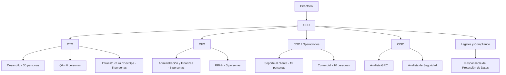

# 01 · Descripción de la organización

> **Aviso:** SaludPay S.A. es una empresa **ficticia** creada para este laboratorio. Cualquier parecido con organizaciones reales es coincidencia.
>
> **Referencia normativa:** ISO/IEC 27001:2022, cláusula 4.1 (comprensión de la organización y su contexto).

| Campo | Valor |
|---|---|
| Razón social | SaludPay S.A. |
| Sede | Ciudad Autónoma de Buenos Aires, Argentina |
| Fundación | 2021 |
| Empleados | 85 (Argentina) + 3 comerciales remotos en EE.UU. |
| Modelo de negocio | SaaS (Software como Servicio) B2B |
| Infraestructura | 100% en la nube (AWS, región us-east-1 y sa-east-1) |
| Facturación anual estimada | USD 6 M |

## 1. ¿Qué hace SaludPay?

SaludPay ofrece una plataforma web y móvil para **clínicas, consultorios y centros médicos** que les permite:

1. **Gestionar turnos**: los pacientes reservan, reprograman o cancelan turnos online.
2. **Cobrar consultas y copagos**: el paciente paga con tarjeta de crédito/débito al reservar o después de la atención.
3. **Recordatorios y comunicaciones**: envío de recordatorios por email, SMS y WhatsApp.
4. **Ficha administrativa del paciente**: datos de contacto, cobertura médica (obra social / prepaga / seguro), motivo de consulta y especialidad.
5. **Reportes para la clínica**: ocupación de agendas, cobranzas, ausentismo.

SaludPay **no** gestiona la historia clínica completa del paciente, pero sí almacena el **motivo de consulta, la especialidad y la cobertura médica**, que son datos que revelan información sobre la salud de la persona.

## 2. Clientes

| Segmento | Cantidad | Ubicación | Observación |
|---|---|---|---|
| Clínicas y centros médicos | 140 | Argentina | Mayoría del negocio |
| Consultorios individuales | 1.200 | Argentina | Plan básico |
| Clínicas ambulatorias | 18 | EE.UU. (Florida y Texas) | Mercado en expansión desde 2025 |

Pacientes registrados en la plataforma: **~1,1 millones** (≈ 1.040.000 en Argentina y ≈ 60.000 en EE.UU.).

## 3. Por qué SaludPay necesita un programa de GRC

| Disparador | Marco aplicable | Motivo |
|---|---|---|
| Trata datos personales y **datos sensibles de salud** de pacientes argentinos | **Ley 25.326** y normativa de la AAIP | Obligación legal |
| Cobra con tarjeta de crédito/débito | **PCI DSS v4.0.1** | Exigencia contractual de las marcas de tarjeta y del adquirente |
| Presta servicios a clínicas de EE.UU. que son *covered entities* | **HIPAA** (Privacy, Security y Breach Notification Rules) | SaludPay actúa como *Business Associate* y firma BAAs |
| Clientes grandes y prepagas exigen certificación en las licitaciones | **ISO/IEC 27001:2022** | Decisión estratégica del Directorio |
| La plataforma no puede caerse en horario de atención | **ISO 22301** | Continuidad del negocio |

## 4. Objetivos de negocio relacionados con la seguridad

1. Obtener la **certificación ISO/IEC 27001** en un plazo de 12 meses.
2. Mantener el cumplimiento **PCI DSS** reduciendo el alcance del entorno de datos de tarjeta (uso de pasarela de pagos tokenizada).
3. Cumplir con los **BAAs firmados** con las clínicas de EE.UU. sin incidentes reportables.
4. Cumplir con la **Ley 25.326**, incluyendo la inscripción de bases de datos y la atención de derechos ARCO (acceso, rectificación, actualización y supresión).
5. Disponibilidad de la plataforma ≥ **99,9%** mensual.

## 5. Contexto interno y externo (análisis resumido)

### Cuestiones internas
- Empresa joven, con crecimiento rápido: los procesos de seguridad se crearon "sobre la marcha" y están poco documentados.
- Equipo de seguridad reducido: 1 CISO y 1 analista de seguridad (posición GRC a cubrir).
- Cultura de desarrollo ágil (Scrum), despliegues frecuentes.
- Fuerte dependencia de proveedores cloud y SaaS.

### Cuestiones externas
- El sector salud es uno de los más atacados por ransomware a nivel mundial.
- Marco regulatorio argentino en discusión: la Ley 25.326 sigue vigente, pero hay proyectos de reforma en el Congreso que podrían acercarla al estándar europeo (RGPD).
- En EE.UU. hay una propuesta de actualización de la HIPAA Security Rule todavía no aprobada; la regla actual sigue en vigor.
- Clientes cada vez más exigentes con cuestionarios de seguridad de proveedores.

## 6. Organigrama simplificado

## 7. Roles clave en seguridad

| Rol | Responsabilidad principal |
|---|---|
| Directorio | Aprueba la política de seguridad y el apetito de riesgo |
| CISO | Dirige el SGSI, reporta al CEO y al Directorio |
| Analista GRC | Gestión de riesgos, políticas, cumplimiento normativo, auditorías internas, evidencias |
| Responsable de Protección de Datos | Cumplimiento de Ley 25.326, derechos de titulares, relación con la AAIP |
| HIPAA Security Officer / Privacy Officer | Rol asignado al CISO y al Responsable de Protección de Datos respectivamente |
| Dueños de activos | Responsables de cada sistema o proceso (ej.: CTO para la plataforma) |
