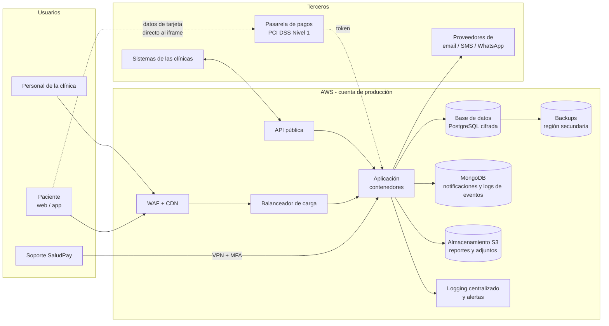

# 03 · Arquitectura y flujos de datos

> **Objetivo:** entender por dónde circula la información sensible. Sin este mapa no se puede hacer un análisis de riesgos serio ni definir el alcance PCI.

## 1. Arquitectura lógica

## 2. Flujos de datos sensibles

### Flujo A — Reserva de turno
1. El paciente se registra: nombre, DNI (a los pacientes de EE.UU. no se les pide SSN), email, teléfono, fecha de nacimiento, cobertura médica.
2. Elige especialidad y profesional, e ingresa el **motivo de consulta** (texto libre).
3. La aplicación guarda el turno en PostgreSQL y dispara un recordatorio.

**Datos sensibles involucrados:** motivo de consulta y especialidad (datos de salud — art. 2 Ley 25.326 / ePHI para HIPAA).

### Flujo B — Cobro
1. En el checkout, la página de SaludPay carga el **formulario de pago embebido (iframe)** de la pasarela.
2. El paciente ingresa los datos de la tarjeta **directamente en el iframe**: los datos nunca pasan por los servidores de SaludPay.
3. La pasarela autoriza el pago y devuelve a SaludPay un **token** y los últimos 4 dígitos.
4. SaludPay guarda el token, el monto y el estado de la transacción.

**Punto de atención PCI:** aunque SaludPay no ve el número de tarjeta, la **página que aloja el iframe** y los scripts que corren en ella están en alcance. Si un atacante modifica esa página (ataque tipo *Magecart*), podría reemplazar el iframe por uno falso. Por eso PCI DSS v4.0.1 pide inventariar y autorizar los scripts de las páginas de pago y detectar cambios no autorizados (requisitos 6.4.3 y 11.6.1).

### Flujo C — Recordatorios
1. La aplicación envía al proveedor de mensajería: nombre, teléfono/email, fecha, hora y nombre de la clínica.
2. **Minimización:** el mensaje **no** incluye la especialidad ni el motivo de consulta (un SMS que dice "su turno en Oncología" ya revela un dato de salud).

### Flujo D — Integración con clínicas
1. Las clínicas consultan turnos y cobranzas por la API pública con OAuth 2.0.
2. Algunas clínicas exportan reportes con datos de pacientes en CSV desde el panel.

**Punto de atención:** las exportaciones CSV son una fuga potencial de datos fuera del control de SaludPay.

### Flujo E — Soporte
1. El equipo de soporte accede al panel administrativo por VPN con MFA.
2. Puede ver datos de pacientes para resolver reclamos.

**Punto de atención:** acceso amplio a datos sensibles por personal no técnico. Requiere mínimo privilegio, registro de accesos y capacitación.

## 3. Ubicación de los datos

| Repositorio | Región AWS | Datos | Transferencia internacional |
|---|---|---|---|
| PostgreSQL principal | sa-east-1 (San Pablo, Brasil) | Pacientes de Argentina | Sí — Brasil |
| PostgreSQL EE.UU. | us-east-1 (Virginia, EE.UU.) | Pacientes de EE.UU. | No aplica Ley 25.326 (pacientes en EE.UU.) |
| Backups | Región cruzada | Copias cifradas | Sí — revisar destino |
| Logging centralizado | us-east-1 | Logs que pueden contener datos personales | **Sí — EE.UU.** |

> ⚠️ **Hallazgo preliminar para la fase de riesgos:** los logs de la plataforma argentina se envían a EE.UU. y pueden contener datos personales. El art. 12 de la Ley 25.326 restringe transferencias a países sin nivel adecuado de protección. Hay que verificar qué mecanismo legal ampara esta transferencia (por ejemplo, cláusulas contractuales modelo aprobadas por la autoridad) o dejar de registrar datos personales en los logs.
