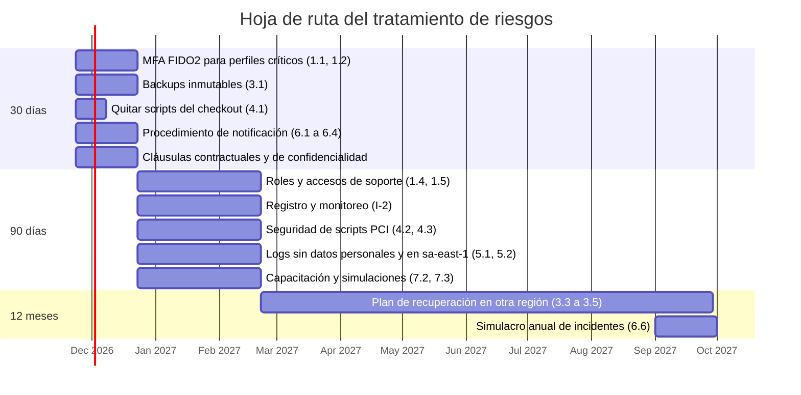

# 02 · Plan de tratamiento de riesgos

> **Referencias normativas:** ISO/IEC 27001:2022, cláusulas 6.1.3 (tratamiento de riesgos) y 8.3 (implementación del tratamiento) · HIPAA Security Rule §164.308(a)(1)(ii)(B) (gestión de riesgos) · PCI DSS v4.0.1, requisito 12.3.1.
> **Versión:** 1.0 · **Estado:** Borrador para aprobación · **Elaborado por:** Analista GRC · **Fecha:** noviembre 2026
> **Insumos:** [Metodología](01-metodologia.md) · [Registro de riesgos](registro-riesgos.csv)

## 1. Resumen ejecutivo

La primera evaluación de riesgos de SaludPay identificó **8 riesgos prioritarios**. Con los controles actuales, el panorama es el siguiente:

| Nivel residual | Cantidad | Riesgos |
|---|---|---|
| 🟥 Crítico | 5 | R-01, R-03, R-04, R-05, R-07 |
| 🟧 Alto | 2 | R-02, R-08 |
| 🟨 Medio | 1 | R-06 |
| 🟩 Bajo | 0 | — |

**Ningún riesgo está dentro del apetito definido por el Directorio**, y dos de ellos (R-02 y R-08) implican incumplimientos legales que no admiten aceptación.

En lugar de 8 planes separados, las **34 acciones** del registro se agrupan en **7 iniciativas**, porque un mismo control suele reducir varios riesgos a la vez. Esto evita duplicar esfuerzos y permite priorizar por impacto.

## 2. Por qué agrupar en iniciativas

Varias acciones del registro se repiten o se superponen:

- El **MFA resistente al phishing** aparece en R-07, pero también protege las credenciales de infraestructura de R-01.
- Los **roles granulares** resuelven a la vez R-03 (soporte) y R-05 (exportación).
- El **registro de eventos** sirve para R-03, R-05 y R-07, y además es lo que permite cumplir R-08: sin registros no se puede investigar una brecha.

> 💡 **Nota de aprendizaje:** esta mirada transversal es lo que distingue un plan de tratamiento de una lista de tareas. Al Directorio no le interesa "cerrar el R-03", sino saber en qué invertir para bajar la mayor cantidad de riesgo.

> ⚠️ **Tensión a resolver:** R-03 y R-05 piden **registrar más** (quién vio qué ficha, quién exportó), mientras R-02 pide **no guardar datos personales en los logs**. No es una contradicción: se registra **quién hizo qué y cuándo** (usuario, acción, ID del paciente), pero **no el contenido** de los datos (nombre, DNI, motivo de consulta).

## 3. Iniciativas

### I-1 · Identidades y accesos
**Riesgos que reduce:** R-01, R-03, R-05, R-07 · **Responsable:** CISO · **Costo estimado:** Medio

| # | Acción | Riesgo | Plazo |
|---|---|---|---|
| 1.1 | MFA resistente al phishing (llaves FIDO2 o passkeys) para infraestructura, soporte y finanzas | R-01, R-07 | 30 días |
| 1.2 | Eliminar claves estáticas de AWS y usar credenciales temporales con MFA | R-01 | 30 días |
| 1.3 | Extender el MFA resistente al phishing al resto de la organización | R-07 | 90 días |
| 1.4 | Roles granulares en el panel de clínicas (secretaria sin permiso de exportación) | R-05 | 90 días |
| 1.5 | Soporte accede solo a fichas vinculadas a un reclamo abierto | R-03 | 90 días |

### I-2 · Registro y monitoreo
**Riesgos que reduce:** R-03, R-04, R-05, R-07, R-08 · **Responsable:** Líder de Infraestructura · **Costo estimado:** Medio

| # | Acción | Riesgo | Plazo |
|---|---|---|---|
| 2.1 | Alertas ante inicios de sesión inusuales | R-07 | 30 días |
| 2.2 | Registro de consultas a fichas de pacientes, con revisión mensual | R-03 | 90 días |
| 2.3 | Registro de cada exportación (quién, cuándo, cuántos registros, qué columnas), visible para la clínica | R-05 | 90 días |
| 2.4 | Alerta ante exportaciones masivas | R-05 | 90 días |
| 2.5 | Detección de cambios en la página de pago, con alertas al menos semanales (PCI DSS 11.6.1) | R-04 | 90 días |

### I-3 · Resiliencia y recuperación
**Riesgos que reduce:** R-01, R-06 · **Responsable:** Líder de Infraestructura · **Costo estimado:** Medio

| # | Acción | Riesgo | Plazo |
|---|---|---|---|
| 3.1 | Backups inmutables (S3 Object Lock) en una cuenta AWS separada | R-01 | 30 días |
| 3.2 | Prueba de restauración trimestral documentada | R-01 | 90 días y luego trimestral |
| 3.3 | Plan de recuperación ante desastres en otra región, con RTO y RPO definidos | R-06 | 12 meses |
| 3.4 | Infraestructura de la región secundaria definida como código, en modalidad en frío | R-06 | 12 meses |
| 3.5 | Prueba anual del plan simulando la caída de sa-east-1 | R-06 | 12 meses |

### I-4 · Seguridad de la página de pago
**Riesgos que reduce:** R-04 · **Responsable:** CTO · **Costo estimado:** Bajo

| # | Acción | Riesgo | Plazo |
|---|---|---|---|
| 4.1 | Quitar de la página de pago los scripts no imprescindibles (chat, analítica) | R-04 | 30 días |
| 4.2 | Inventario, justificación, autorización e integridad de los scripts restantes, con CSP estricta (PCI DSS 6.4.3) | R-04 | 90 días |
| 4.3 | Evaluación de seguridad de los proveedores de scripts y cláusula de aviso de incidentes | R-04 | 90 días |

### I-5 · Protección de datos personales
**Riesgos que reduce:** R-02, R-03, R-05 · **Responsable:** Responsable de Protección de Datos · **Costo estimado:** Bajo

| # | Acción | Riesgo | Plazo |
|---|---|---|---|
| 5.1 | Enmascarar o eliminar datos personales de los logs | R-02 | 90 días |
| 5.2 | Mover los logs de la plataforma argentina a la región sa-east-1 | R-02 | 90 días |
| 5.3 | Mientras tanto, cláusulas contractuales modelo con el proveedor de logging | R-02 | 30 días |
| 5.4 | Ocultar el motivo de consulta al rol de soporte | R-03 | 90 días |
| 5.5 | Exportación sin motivo de consulta por defecto | R-05 | 90 días |
| 5.6 | Cláusula de confidencialidad específica sobre datos de salud para el personal | R-03 | 30 días |
| 5.7 | Cláusula contractual con las clínicas sobre la responsabilidad por los datos exportados | R-05 | 90 días |

### I-6 · Gestión de incidentes y notificación
**Riesgos que reduce:** R-08, R-01 · **Responsable:** CISO / Legales · **Costo estimado:** Bajo

| # | Acción | Riesgo | Plazo |
|---|---|---|---|
| 6.1 | Procedimiento de notificación de brechas con plazos HIPAA y de cada BAA | R-08 | 30 días |
| 6.2 | Criterio documentado para decidir si un incidente es una brecha notificable | R-08 | 30 días |
| 6.3 | Registro actualizado de contactos de seguridad de cada clínica | R-08 | 30 días |
| 6.4 | Plantilla de notificación con el contenido exigido | R-08 | 30 días |
| 6.5 | Plan de respuesta específico para ransomware | R-01 | 90 días |
| 6.6 | Simulacro anual de incidente y notificación (clínicas de EE.UU. y Argentina) | R-08 | 12 meses |

### I-7 · Concientización
**Riesgos que reduce:** R-07, R-03 · **Responsable:** CISO / RRHH · **Costo estimado:** Bajo

| # | Acción | Riesgo | Plazo |
|---|---|---|---|
| 7.1 | Botón y procedimiento para reportar correos sospechosos | R-07 | 30 días |
| 7.2 | Capacitación obligatoria trimestral (incluye confidencialidad de datos de salud) | R-07, R-03 | 90 días y luego trimestral |
| 7.3 | Simulaciones periódicas de phishing con métricas | R-07 | 90 días y luego trimestral |

## 4. Priorización

Criterios, en este orden:
1. **Obligación legal:** lo que implica un incumplimiento normativo va primero (R-02, R-08).
2. **Nivel de riesgo residual:** los críticos antes que los altos.
3. **Cantidad de riesgos que reduce:** una acción que baja cuatro riesgos vale más que una que baja uno.
4. **Costo y esfuerzo:** a igualdad de condiciones, primero las "victorias rápidas" (bajo costo y alto impacto).

### Hoja de ruta

**Victorias rápidas de los primeros 30 días:** quitar scripts del checkout (bajo costo, ataca un riesgo crítico), backups inmutables y MFA resistente al phishing para los perfiles críticos (atacan los dos riesgos que pueden paralizar la empresa), y el procedimiento de notificación (bajo costo, resuelve un incumplimiento legal).

## 5. Riesgo objetivo

El **riesgo objetivo** es el nivel esperado **después** de implementar las acciones. Se evalúa con la misma metodología: para cada acción, ¿baja la probabilidad, el impacto o los dos?

| Riesgo | Residual actual | P objetivo | I objetivo | Riesgo objetivo | ¿Dentro del apetito? | Justificación |
|---|---|---|---|---|---|---|
| R-01 Ransomware | 🟥 15 | 2 | 4 | 🟨 8 | Sí, con aceptación del dueño y el CISO | El MFA y las credenciales temporales dificultan el acceso (baja P); los backups inmutables y probados evitan perder datos, pero un ataque podría robar datos antes de cifrar, así que el impacto en pacientes sigue siendo 4 |
| R-02 Logs a EE.UU. | 🟧 12 | 1 | 3 | 🟩 3 | Sí | Si los logs ya no contienen datos personales y quedan en sa-east-1, la transferencia prácticamente desaparece |
| R-03 Soporte | 🟥 16 | 2 | 4 | 🟨 8 | Sí, con aceptación del dueño y el CISO | El acceso por reclamo y el registro revisado hacen difícil y detectable el acceso indebido (baja P); si ocurre, el dato sigue siendo de salud |
| R-04 Skimming | 🟥 16 | ✍️ | ✍️ | ✍️ | ✍️ | ✍️ |
| R-05 Exportación | 🟥 16 | ✍️ | ✍️ | ✍️ | ✍️ | ✍️ |
| R-06 Caída de AWS | 🟨 8 | ✍️ | ✍️ | ✍️ | ✍️ | ✍️ |
| R-07 Phishing | 🟥 16 | ✍️ | ✍️ | ✍️ | ✍️ | ✍️ |
| R-08 Notificación | 🟧 12 | ✍️ | ✍️ | ✍️ | ✍️ | ✍️ |

> ✍️ **Ejercicio:** completar R-04 a R-08.

## 6. Aprobación y aceptación del riesgo residual

ISO 27001 (cl. 6.1.3 f) exige que **los dueños de los riesgos aprueben el plan y acepten el riesgo residual**. Esta firma es la que convierte el plan en un compromiso de la organización.

| Riesgo | Dueño | Aprueba el plan | Acepta el riesgo objetivo | Fecha |
|---|---|---|---|---|
| R-01 | CTO | ☐ | ☐ | |
| R-02 | Responsable de Protección de Datos | ☐ | ☐ | |
| R-03 | COO | ☐ | ☐ | |
| R-04 | CTO | ☐ | ☐ | |
| R-05 | COO | ☐ | ☐ | |
| R-06 | CTO | ☐ | ☐ | |
| R-07 | COO | ☐ | ☐ | |
| R-08 | CISO | ☐ | ☐ | |

**Aprobación final del plan:** CEO ☐ · Fecha: ____

## 7. Seguimiento

El plan se revisa **mensualmente** en el comité de seguridad. Indicadores:

| Indicador | Meta | Iniciativa |
|---|---|---|
| Acciones del plan completadas en plazo | ≥ 90% | Todas |
| Cuentas privilegiadas con MFA resistente al phishing | 100% a los 30 días | I-1 |
| Pruebas de restauración exitosas | 4 de 4 por año | I-3 |
| Scripts en la página de pago inventariados y autorizados | 100% | I-4 |
| Tasa de clic en simulaciones de phishing | < 5% al cabo de un año | I-7 |
| Tasa de reporte de correos sospechosos en simulaciones | > 60% | I-7 |
| Tiempo entre el descubrimiento de una brecha y la notificación a la clínica | Dentro del plazo del BAA en el 100% de los casos | I-6 |

Cuando una acción se completa, se actualiza el **estado** en el registro y se reevalúa el riesgo residual con evidencia de que el control funciona.
